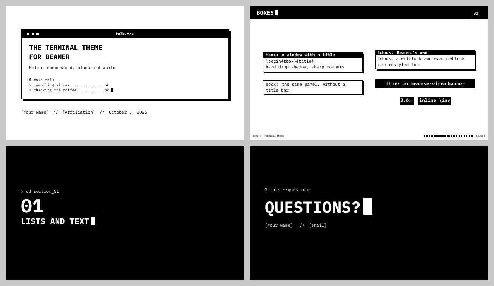

# beamer-theme-terminal

A retro, monospaced, black-and-white Beamer theme: inverse-video frame titles with a blinking-style cursor, window boxes with hard drop shadows, terminal-style section screens, and a block progress bar.



See the full demo: [`docs/demo.pdf`](docs/demo.pdf).

## Quick start

Copy `beamerthemeterminal.sty` next to your `.tex` file, then:

```latex
\documentclass[aspectratio=169,10pt]{beamer}
\usetheme{terminal}

\title{My Talk}
\author{Me}

\begin{document}
\begin{frame}[plain,noframenumbering]
  \titlepage
\end{frame}

\section{INTRO}
\begin{frame}{Hello}
  \begin{tbox}{> whoami}
    a box with a window title
  \end{tbox}
\end{frame}
\end{document}
```

Compile with **XeLaTeX** or **LuaLaTeX** (the theme uses `fontspec`), twice so the frame count is right. With pdfLaTeX the theme stops with an error that says so.

**On Overleaf:** Menu → Settings → Compiler → XeLaTeX.

## Fonts

The theme uses [IBM Plex Mono](https://github.com/IBM/plex) (SIL Open Font License), which ships with TeX Live, so it works on Overleaf with no setup. If the font can't be found, the theme falls back to Latin Modern Mono and prints a warning. Math stays in Computer Modern.

## Options

```latex
\usetheme[nosectionpages,noprogressbar]{terminal}
```

| option           | effect                                          |
|------------------|-------------------------------------------------|
| `nosectionpages` | no black section screen at each `\section`      |
| `noprogressbar`  | no block progress bar in the footline           |

## Settings

| command                          | effect                                                    |
|----------------------------------|-----------------------------------------------------------|
| `\terminalfootprefix{mytool}`    | footline reads `mytool :: <short title>`                  |
| `\terminalwindow{talk.tex}`      | label in the title-page window bar                        |
| `\terminalshell{\$ make\\> ok}`  | fake shell lines on the title page (`\\` between lines)   |

## Environments and commands

| name                                 | what it does                                         |
|--------------------------------------|------------------------------------------------------|
| `\begin{tbox}[opts]{title}`          | window box with a black title bar and drop shadow    |
| `\begin{pbox}[opts]`                 | the same panel without a title                       |
| `\begin{ibox}[opts]`                 | centred inverse-video banner                         |
| `block`, `alertblock`, `exampleblock`| Beamer's blocks, restyled as window boxes            |
| `\inv{text}`                         | inline inverse video                                 |
| `\src{citation}`                     | tiny source note at the bottom right of a frame      |
| `\terminalcursor` (or `\cursor`)     | the block cursor                                     |
| `\terminalscreen{prompt}{BIG}{small}`| full black frame, e.g. for "QUESTIONS?"              |

`[opts]` are passed to `tcolorbox`, e.g. `\begin{tbox}[width=0.8\linewidth]{title}`.

Section numbers appear in the frame title as `[01]`. For backup slides that don't count toward the total, load `appendixnumberbeamer` and use `\appendix`.

## License

[MIT](LICENSE). IBM Plex Mono is not included in this repository; it is distributed separately under the SIL Open Font License.

## Credits

This theme was designed and written in collaboration with Claude, an AI assistant made by Anthropic. It grew out of an academic presentation: Claude drafted the original slide styling and later packaged it into this standalone theme, demo, and documentation, while skhakim shaped the design, tested it, and maintains the repository. Bug reports and improvements are welcome, from humans and machines alike.